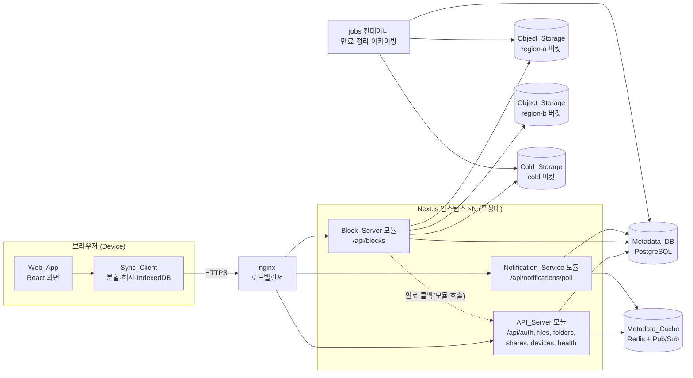
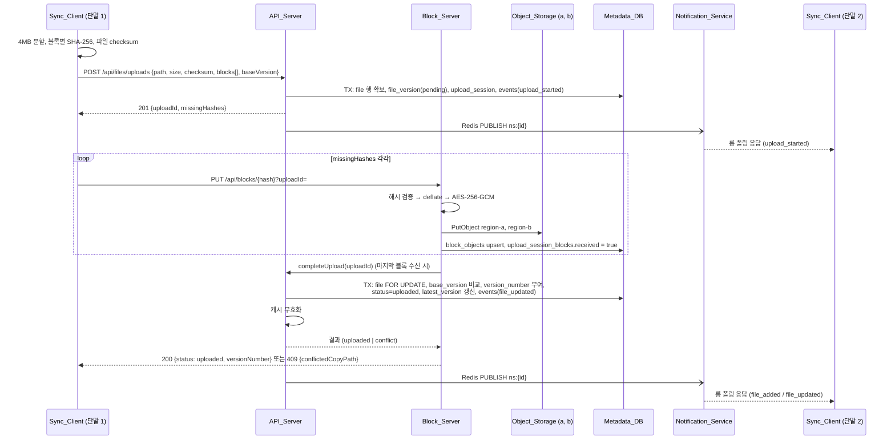
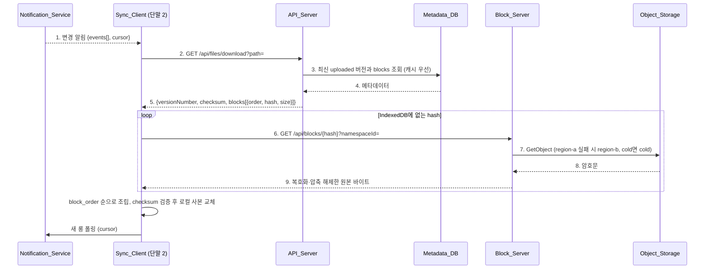
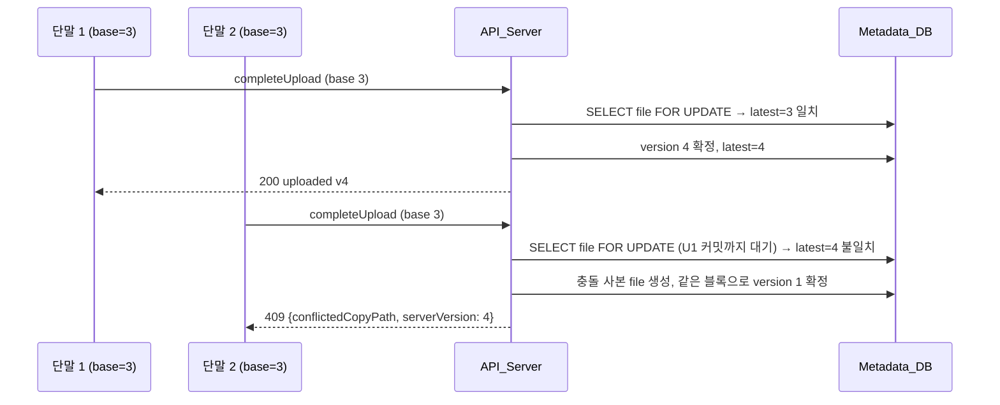

# Design Document: Google Drive System

## Overview

이 문서는 requirements.md의 요구사항 1~17을 Next.js 풀스택 애플리케이션 하나로 구현하기 위한 설계다.
책 15장의 컴포넌트 구분(API 서버, 블록 저장소 서버, 알림 서비스, 메타데이터 DB·캐시, 클라우드·아카이빙 저장소, 오프라인 백업 큐)은
배포 단위가 아니라 `src/server/` 아래의 모듈 경계로 유지한다. 인스턴스는 하나의 Next.js 이미지를 여러 개 띄워 수평 확장한다.

### 목표

- 파일을 클라이언트에서 4MB 블록으로 나누고, 바뀐 블록만 올리는 델타 동기화와 이어 올리기를 구현한다
- 블록은 서버에서 압축 후 AES-256-GCM으로 암호화해 두 지역 버킷에 모두 기록한다
- 메타데이터는 PostgreSQL 트랜잭션으로 강한 일관성을 보장하고, Redis 캐시는 커밋 직후 무효화한다
- 같은 기준 버전에서 출발한 동시 업로드는 먼저 완료된 쪽만 최신 버전이 되고 나머지는 충돌 사본으로 보존한다
- 롱 폴링과 영속 이벤트 로그로 접속 중인 단말에는 즉시, 오프라인 단말에는 재접속 시 변경을 전달한다
- 각 규칙을 fast-check 속성 테스트로 검증한다

### 기술 스택 선택

| 영역 | 선택 | 이유 |
|------|------|------|
| 프레임워크 | Next.js 16 (App Router), React 19, TypeScript | 사용자 요청. 화면과 Route Handler를 한 코드베이스에서 관리 |
| 런타임 | Node.js 22 (Route Handler는 `runtime = 'nodejs'`) | `node:zlib`, `node:crypto`, 장시간 롱 폴링 연결 필요 |
| 메타데이터 DB | PostgreSQL 16 | ACID 트랜잭션, `SELECT ... FOR UPDATE`, 부분 유니크 인덱스, 트리거 |
| ORM / 마이그레이션 | Drizzle ORM 0.45 + drizzle-kit, 드라이버 `postgres` | SQL에 가까운 쿼리, 타입 추론, SQL 마이그레이션 파일 생성 |
| 캐시 / 알림 깨우기 | Redis 7 (`ioredis`) | 메타데이터 캐시, 롱 폴링 대기자를 깨우는 Pub/Sub |
| 객체 저장소 | MinIO (`@aws-sdk/client-s3`) | S3 API 호환. 버킷 3개로 주 지역·복제 지역·아카이빙 저장소를 흉내 |
| 인증 | `jose`(JWT HS256), `bcryptjs` | 외부 인증 서버 없이 토큰 발급·검증 |
| 입력 검증 | `zod` 4 | Route Handler 요청 바디·쿼리 스키마 검증 |
| 브라우저 해시 | `hash-wasm` (증분 SHA-256), Web Crypto | 10GB 파일도 메모리에 다 올리지 않고 checksum 계산 |
| 브라우저 로컬 사본 | IndexedDB (`idb`) | 블록 캐시, 파일별 동기화 상태, 이벤트 커서 저장 |
| 테스트 | Vitest 5, fast-check 4, Playwright 1.64 | 단위·속성 테스트, 두 브라우저 컨텍스트로 다중 단말 E2E |
| 실행 환경 | Docker Compose | app ×2, nginx, postgres, redis, minio, jobs |

> 구현 착수 시점에 각 패키지의 최신 안정판과 Next.js 16 문서(Route Handler, `proxy.ts`)를 다시 확인한다.

---

## Architecture

### 시스템 아키텍처 다이어그램



- 책의 오프라인 사용자 백업 큐는 PostgreSQL `events` 테이블(영속 이벤트 로그)과 단말별 커서로 구현한다. 근거는 아래 "알림과 오프라인 백업 큐 설계 결정"에 있다.
- 책은 클라우드 저장소가 완료 콜백을 API 서버로 보낸다. MinIO 이벤트 알림 대신, Block_Server 모듈이 두 버킷 기록을 마친 뒤 API_Server 모듈의 `completeUpload()`를 직접 호출하는 것으로 대체한다. 같은 프로세스 안의 호출이지만 인터페이스(`UploadCompletionHandler`)로만 의존한다.

### 업로드 흐름 시퀀스 다이어그램



- `missingHashes`가 비어 있으면(모든 블록이 이미 계정에 있으면) `POST /api/files/uploads`가 그 자리에서 `completeUpload()`까지 수행하고 결과를 돌려준다.
- `version_number`는 pending 시점이 아니라 완료 트랜잭션 안에서 부여한다. 만료된 업로드가 번호를 차지하지 않게 하여 요구사항 7.5(1씩 증가)를 지킨다.

### 다운로드 흐름 시퀀스 다이어그램



### 동기화 충돌 흐름



- 충돌 사본은 이미 저장된 블록을 그대로 참조하므로 블록을 다시 올리지 않는다.
- 행 잠금(`FOR UPDATE`)으로 같은 파일의 완료 처리를 직렬화한다(요구사항 8.6).

### 알림과 오프라인 백업 큐 설계 결정

| 선택지 | 장점 | 단점 | 결정 |
|--------|------|------|------|
| 단말별 큐(Redis List 등)에 이벤트 복사 | 책 그림과 구조가 같음 | 공유 폴더 이벤트를 단말 수만큼 복제, 큐 장애 시 유실 대비 필요 | 제외 |
| 네임스페이스별 영속 이벤트 로그 + 단말별 커서 | 메타데이터 변경과 같은 트랜잭션에 기록(트랜잭셔널 아웃박스)되어 유실 없음, 복제 없음 | 폴링 시 접근 가능한 네임스페이스 조회 필요 | **채택** |

- 이벤트는 메타데이터 변경과 같은 트랜잭션에서 `events`에 INSERT된다. 커밋 후 Redis로 `PUBLISH`해 대기 중인 롱 폴링을 깨운다.
- Redis 발행이 실패해도 이벤트는 DB에 남는다. 대기 중인 클라이언트는 60초 타임아웃 후 재폴링할 때 받는다. 발행은 최대 5회 재시도한다(요구사항 15.4).
- "Device에 활성 연결이 없는 동안 보관"(요구사항 12.1)은 로그의 30일 보관과 단말 커서로 충족한다. 단말이 재접속해 커서 이후 이벤트를 순서대로 받는다.

---

## Components and Interfaces

모든 Route Handler는 `export const runtime = 'nodejs'`, `export const dynamic = 'force-dynamic'`을 선언한다.
Next.js 16에서 동적 세그먼트 `params`는 Promise이므로 `const { hash } = await params`로 읽는다.
인증은 `proxy.ts`가 아니라 각 핸들러의 `withAuth()` 래퍼에서 처리한다. 롱 폴링·블록 업로드처럼 본문과 연결 수명을 직접 다뤄야 하는 경로가 있기 때문이다.

### 공통: 인증과 단말 확인 (`src/server/auth/`)

| 함수 | 설명 |
|------|------|
| `hashPassword(pw)`, `verifyPassword(pw, hash)` | bcryptjs, cost 10 |
| `issueAccessToken(userId)` | HS256 JWT, `exp` 60분, `sub=userId` (요구사항 1.1) |
| `withAuth(handler, { requireDevice })` | `Authorization: Bearer` 또는 httpOnly 쿠키 `access_token` 검증 → 실패 시 401. `requireDevice`면 `X-Device-Id`가 해당 사용자의 단말인지 확인 → 아니면 403 (요구사항 1.2, 1.3, 1.7) |

### API_Server 모듈

| 메서드·경로 | 요청 | 응답 | 요구사항 |
|-------------|------|------|----------|
| `POST /api/auth/signup` | `{email, password(8~72자), userName(1~64자)}` | 201 `{userId}`. 루트 namespace 생성, quota 10GB | 1.6 |
| `POST /api/auth/login` | `{email, password}` | 200 `{accessToken}` + `Set-Cookie` | 1.1 |
| `POST /api/devices` | `{name(1~64자)}` | 201 `{deviceId}`. 사용자당 10대 초과 시 409 | 1.4, 1.5 |
| `GET /api/files?path=/a&namespaceId=` | 폴더 경로 | 200 `{items:[{name, isDirectory, size, latestVersion, lastModified, owner}]}` | 2.5 |
| `POST /api/folders` | `{namespaceId, path}` | 201 `{fileId}` | 2.2~2.4 |
| `DELETE /api/files?path=&namespaceId=` | | 204. 폴더면 하위 전체 soft delete | 9.1, 9.2 |
| `POST /api/files/uploads` | `{namespaceId, path, size, checksum, blocks:[{hash, size}], baseVersion?}` | 201 `{uploadId, missingHashes}` 또는 (누락 블록 없음) 200/409 완료 결과 | 4.1~4.5 |
| `GET /api/files/uploads/{uploadId}` | | 200 `{status, missingHashes, expiresAt}` | 5.1 |
| `GET /api/files/download?path=&namespaceId=&version=` | | 200 `{versionNumber, size, checksum, blocks:[{order, hash, size}]}` | 6.1~6.3 |
| `GET /api/files/revisions?path=&namespaceId=&limit=` | limit 1~100, 기본 20 | 200 `{revisions:[{versionNumber, size, checksum, deviceId, lastModified, kept}]}` | 7.1~7.3 |
| `POST /api/files/revisions/keep` | `{fileVersionId, kept}` | 204 | 14.4 |
| `POST /api/shares` | `{namespaceId, folderPath, email, role: viewer\|editor}` | 201 `{shareId}` | 10.1, 10.2 |
| `DELETE /api/shares/{shareId}` | | 204 | 10.5 |
| `GET /api/shares` | | 200 공유받은 폴더 목록 | 17.1 |
| `GET /api/health` | | 200 / 503 `{db, cache, objectStorage, notification}` | 15.6 |

핵심 서비스 함수(`src/server/files/`):

```ts
// uploadService.ts
startUpload(ctx: AuthContext, req: StartUploadRequest): Promise<StartUploadResult>
getUploadStatus(ctx: AuthContext, uploadId: string): Promise<UploadStatus>
completeUpload(uploadId: string): Promise<CompletionResult>   // UploadCompletionHandler 구현

type CompletionResult =
  | { status: 'uploaded'; fileId: number; versionNumber: number }
  | { status: 'conflict'; conflictedCopyPath: string; serverVersion: number }

// conflict.ts (순수 함수)
conflictedCopyName(fileName: string, userName: string, date: Date, existing: Set<string>): string
// pathRules.ts (순수 함수)
normalizePath(path: string): string          // 형식 검증, '//' '.' '..' 거부
parentOf(path: string): string
isUnder(path: string, folder: string): boolean
```

`completeUpload` 트랜잭션 순서:

1. `upload_sessions`를 `FOR UPDATE`로 읽어 이미 처리된 세션이면 저장된 결과를 그대로 반환한다(멱등).
2. 대상 `files` 행을 `FOR UPDATE`로 잠근다.
3. `base_version`(새 파일이면 `null`)과 `files.latest_version`을 비교한다.
   - 같으면 `version_number = coalesce(latest_version, 0) + 1`을 부여하고 `status = 'uploaded'`, `files.latest_version/size/checksum/last_modified`를 갱신한다.
   - 다르면 같은 폴더에 충돌 사본 `files` 행을 만들고, 이번 `file_version`을 그 파일의 version 1로 옮겨 확정한다.
4. 사용량(`users.used_bytes`)을 `새 크기 - 이전 최신 크기`만큼 조정한다. 할당량을 넘으면 롤백하고 507을 반환한다.
5. `events`에 `file_added`/`file_updated` 행을 INSERT한다.
6. 커밋 후 캐시 무효화와 `PUBLISH ns:{namespaceId}`를 수행한다.

### Block_Server 모듈 (`src/server/block/`, `/api/blocks/[hash]`)

| 메서드·경로 | 동작 | 요구사항 |
|-------------|------|----------|
| `PUT /api/blocks/{hash}?uploadId=` | 본문(≤4MB)의 SHA-256 검증 → 계정에 같은 hash가 있으면 저장 생략 → 없으면 `deflateRaw` 후 AES-256-GCM 암호화 → region-a, region-b 모두 `PutObject` → `block_objects` upsert, `upload_session_blocks.received=true` → 남은 블록이 없으면 `completeUpload()` 호출 결과 반환 | 3.3~3.5, 5.2, 14.1 |
| `GET /api/blocks/{hash}?namespaceId=` | 해당 namespace에서 접근 가능한 파일 버전이 이 hash를 참조하는지 확인 → tier에 따라 region-a(실패 시 region-b) 또는 cold에서 읽기 → 복호화·압축 해제 → `last_accessed_at` 갱신, cold였다면 hot으로 되돌림 | 3.6, 14.6, 15.1 |

```ts
// blockCodec.ts (순수 함수, 키 주입)
encodeBlock(plain: Uint8Array, key: Uint8Array): Uint8Array   // [iv 12B][tag 16B][ciphertext]
decodeBlock(stored: Uint8Array, key: Uint8Array): Uint8Array
// objectStorage.ts
interface BlockStore {
  putReplicated(key: string, body: Uint8Array): Promise<void>  // a, b 둘 다 성공해야 resolve
  getWithFallback(key: string, tier: 'hot' | 'cold'): Promise<Uint8Array>
  moveToCold(key: string): Promise<void>
  moveToHot(key: string): Promise<void>
}
```

- 객체 키: `blocks/{accountId}/{hash}`. `accountId`는 블록이 속한 namespace 소유자의 user_id다. 공유 폴더에 editor가 올린 블록도 소유자 계정으로 중복 제거되고 소유자 할당량에 잡힌다.
- 암호화 키 `BLOCK_ENCRYPTION_KEY`(32바이트 base64)는 환경 변수로만 주입한다(요구사항 3.8).
- 압축은 블록 단위로 적용한다. 이미 압축된 형식(jpg, mp4, zip)은 압축 후가 더 커질 수 있으므로, 압축 결과가 원본 이상이면 원본을 저장하고 헤더 플래그 1바이트로 구분한다.

### Notification_Service 모듈 (`src/server/notification/`, `/api/notifications/poll`)

```
GET /api/notifications/poll?cursor={lastEventId}
Headers: Authorization, X-Device-Id
```

1. 커서가 가장 오래된 보관 이벤트 ID보다 작으면 410 `CURSOR_EXPIRED`를 반환한다(요구사항 12.4).
2. 사용자가 접근 가능한 namespace 목록(소유 + 공유받은 폴더)을 구한다.
3. `events WHERE namespace_id IN (...) AND id > cursor AND device_id <> 요청 단말 ORDER BY id LIMIT 100`을 조회한다. 공유 폴더 이벤트는 해당 폴더 경로 하위만 남긴다. 결과가 있으면 즉시 200을 반환한다.
4. 없으면 각 namespace의 Redis 채널 `ns:{id}`를 구독하고, 메시지 수신·60초 경과·`request.signal` abort 중 먼저 오는 것을 기다린다. 메시지가 오면 3번을 다시 수행해 응답한다. 60초가 지나면 200 `{events: [], cursor}`를 반환한다(요구사항 11.2).
5. 프로세스별 동시 연결 수가 `LONG_POLL_MAX_CONNECTIONS`(기본 10,000)에 도달하면 503과 `Retry-After: 5`를 반환한다(요구사항 11.7).

```ts
type DriveEvent = {
  id: number                // bigserial, 전역 단조 증가
  type: 'file_added' | 'file_updated' | 'file_deleted' | 'upload_started' | 'share_created'
  namespaceId: number
  path: string
  versionNumber: number | null
  deviceId: string | null
  createdAt: string
}
```

### Metadata_Cache (`src/server/cache/metadataCache.ts`)

- 읽기: 캐시 적중 시 반환, 미스 시 DB 조회 후 TTL 600초로 저장. Redis 오류는 로그만 남기고 DB 결과를 반환한다(요구사항 13.4, 13.5).
- 쓰기: 트랜잭션 커밋 후 영향받는 키를 `DEL`한다. 트랜잭션 안에서는 지우지 않는다. 커밋 전에 지우면 다른 요청이 옛 값을 다시 채울 수 있기 때문이다.
- 커밋과 DEL 사이에 끼어든 읽기가 옛 값을 다시 캐시하는 경쟁을 막기 위해 캐시 값에 `latest_version`을 함께 저장한다. DB 커밋 후 `DEL`과 함께 `meta:ver:{fileId}`를 증가시키고, 읽기 쪽은 채울 때 이 버전 카운터가 바뀌지 않았을 때만 `SET`한다(Lua 스크립트로 비교 후 저장).

### Sync_Client (`src/client/sync/`)

| 파일 | 역할 | 요구사항 |
|------|------|----------|
| `chunker.ts` | `File`을 `Blob.slice`로 4MB씩 읽는 async iterator | 3.1 |
| `hasher.ts` | 블록 SHA-256(Web Crypto), 파일 전체 SHA-256(hash-wasm 증분) | 3.2 |
| `blockCache.ts` | IndexedDB `blocks`(hash→bytes), `files`(path→{version, hashes}), `meta`(cursor) 저장소 | 6.4 |
| `uploader.ts` | `startUpload` → missingHashes만 동시 4개로 PUT → 진행률 이벤트, 오류 시 일시 중지 상태 보관, 재개 시 `GET uploads/{id}` | 5.1~5.3, 17.2, 17.3 |
| `downloader.ts` | 메타데이터 조회 → 캐시에 없는 블록만 GET → 조립 → checksum 검증, 실패 시 최대 3회 재시도 | 6.4, 6.5 |
| `poller.ts` | 롱 폴링 루프. 응답마다 이벤트 처리 후 즉시 재요청, 네트워크 오류·503이면 1초부터 2배씩 최대 60초 백오프, 410이면 전체 동기화 | 11.5, 12.4, 15.5 |

### Web_App (`src/app/(drive)/`)

| 경로 | 화면 |
|------|------|
| `/login`, `/signup` | 로그인·가입. 첫 로그인 시 브라우저별 Device 등록 후 `deviceId`를 IndexedDB에 저장 |
| `/drive/[[...path]]` | 내 드라이브 폴더 탐색, 드래그 앤 드롭 업로드, 진행률, 폴더 생성, 삭제 |
| `/shared` | 공유 문서함 |
| `/recent` | 최근 수정한 파일 50개 |
| `/trash` | 삭제한 파일(30일 이내) |
| 파일 상세 패널 | 갱신 이력, 버전 다운로드, 보관 표시, 공유 대화상자 |

### jobs 컨테이너 (`scripts/run-jobs.ts`)

`tsx`로 실행하는 단일 프로세스가 아래 작업을 주기적으로 돈다. 각 작업은 `pg_try_advisory_lock`으로 한 인스턴스만 실행한다.

| 작업 | 주기 | 요구사항 |
|------|------|----------|
| `expireUploads` | 1분 | 24시간 지난 pending 업로드 만료 (4.8) |
| `pruneVersions` | 10분 | 파일당 uploaded 버전 100개 초과분 중 kept가 아닌 오래된 것 삭제 (14.3, 14.4) |
| `purgeDeleted` | 1시간 | 삭제 30일 지난 파일의 버전 정리, 참조 없는 블록 객체 삭제 (9.3) |
| `archiveColdBlocks` | 1시간 | `last_accessed_at`이 90일 지난 hot 블록을 cold 버킷으로 이동 (14.5) |
| `purgeEvents` | 1시간 | 30일 지난 이벤트 삭제 (12.3) |

시간 기준값(24시간, 30일, 90일)은 환경 변수로 바꿀 수 있게 하여 통합 테스트에서 짧게 설정한다.

---

## Data Models

### PostgreSQL 스키마

책 그림 15-13의 `user`, `device`, `namespace`, `file`, `file_version`, `block`을 기준으로 하고, 업로드 세션·중복 제거·공유·이벤트 테이블을 더했다.
책과 달리 `checksum`은 SHA-256 hex(`char(64)`)로 저장한다.

```sql
CREATE TABLE users (
  id            bigserial PRIMARY KEY,
  email         varchar(254) NOT NULL UNIQUE,
  user_name     varchar(64)  NOT NULL,
  password_hash varchar(72)  NOT NULL,
  quota_bytes   bigint NOT NULL DEFAULT 10737418240,
  used_bytes    bigint NOT NULL DEFAULT 0 CHECK (used_bytes >= 0),
  created_at    timestamptz NOT NULL DEFAULT now()
);

CREATE TABLE devices (
  id                uuid PRIMARY KEY DEFAULT gen_random_uuid(),
  user_id           bigint NOT NULL REFERENCES users(id),
  name              varchar(64) NOT NULL,
  push_id           varchar(255),
  last_logged_in_at timestamptz,
  created_at        timestamptz NOT NULL DEFAULT now()
);
CREATE INDEX devices_user_idx ON devices(user_id);

CREATE TABLE namespaces (
  id         bigserial PRIMARY KEY,
  owner_id   bigint NOT NULL UNIQUE REFERENCES users(id),
  is_shared  boolean NOT NULL DEFAULT false,
  created_at timestamptz NOT NULL DEFAULT now()
);

CREATE TABLE files (
  id             bigserial PRIMARY KEY,
  namespace_id   bigint NOT NULL REFERENCES namespaces(id),
  file_name      varchar(255) NOT NULL,
  relative_path  varchar(1024) NOT NULL,
  is_directory   boolean NOT NULL,
  latest_version integer,                -- uploaded 버전이 하나도 없으면 NULL (목록에서 제외)
  size           bigint NOT NULL DEFAULT 0,
  checksum       char(64),
  deleted_at     timestamptz,
  created_at     timestamptz NOT NULL DEFAULT now(),
  last_modified  timestamptz NOT NULL DEFAULT now()
);
CREATE UNIQUE INDEX files_live_path_uniq ON files(namespace_id, relative_path) WHERE deleted_at IS NULL;
CREATE INDEX files_modified_idx ON files(namespace_id, last_modified DESC);

CREATE TABLE file_versions (
  id             bigserial PRIMARY KEY,
  file_id        bigint NOT NULL REFERENCES files(id),
  device_id      uuid REFERENCES devices(id),
  version_number integer,                -- 완료 트랜잭션에서 부여, pending/expired는 NULL
  status         varchar(16) NOT NULL CHECK (status IN ('pending', 'uploaded', 'expired')),
  base_version   integer,
  size           bigint NOT NULL CHECK (size BETWEEN 0 AND 10737418240),
  checksum       char(64) NOT NULL,
  created_at     timestamptz NOT NULL DEFAULT now(),
  last_modified  timestamptz NOT NULL DEFAULT now(),
  UNIQUE (file_id, version_number),
  CHECK ((status = 'uploaded') = (version_number IS NOT NULL))
);

-- uploaded 레코드는 읽기 전용 (요구사항 7.4). 정리 작업의 DELETE는 허용한다.
CREATE FUNCTION forbid_uploaded_version_update() RETURNS trigger AS $$
BEGIN
  IF OLD.status = 'uploaded' THEN
    RAISE EXCEPTION 'file_versions % is read-only', OLD.id;
  END IF;
  RETURN NEW;
END $$ LANGUAGE plpgsql;
CREATE TRIGGER file_versions_read_only BEFORE UPDATE ON file_versions
  FOR EACH ROW EXECUTE FUNCTION forbid_uploaded_version_update();

CREATE TABLE file_version_keeps (       -- 보관 표시 (버전 레코드를 수정하지 않기 위해 분리)
  file_version_id bigint PRIMARY KEY REFERENCES file_versions(id) ON DELETE CASCADE,
  created_at      timestamptz NOT NULL DEFAULT now()
);

CREATE TABLE blocks (                   -- 책의 block 테이블: 버전별 블록 순서
  id              bigserial PRIMARY KEY,
  file_version_id bigint NOT NULL REFERENCES file_versions(id) ON DELETE CASCADE,
  block_order     integer NOT NULL CHECK (block_order >= 0),
  hash            char(64) NOT NULL,
  size            integer NOT NULL CHECK (size BETWEEN 1 AND 4194304),
  UNIQUE (file_version_id, block_order)
);
CREATE INDEX blocks_hash_idx ON blocks(hash);

CREATE TABLE block_objects (            -- 계정 단위 중복 제거 레지스트리
  account_id       bigint NOT NULL REFERENCES users(id),
  hash             char(64) NOT NULL,
  size             integer NOT NULL,
  stored_size      integer NOT NULL,
  storage_tier     varchar(8) NOT NULL DEFAULT 'hot' CHECK (storage_tier IN ('hot', 'cold')),
  last_accessed_at timestamptz NOT NULL DEFAULT now(),
  created_at       timestamptz NOT NULL DEFAULT now(),
  PRIMARY KEY (account_id, hash)
);

CREATE TABLE upload_sessions (
  id              uuid PRIMARY KEY DEFAULT gen_random_uuid(),
  file_version_id bigint NOT NULL UNIQUE REFERENCES file_versions(id),
  account_id      bigint NOT NULL REFERENCES users(id),
  user_id         bigint NOT NULL REFERENCES users(id),
  status          varchar(16) NOT NULL CHECK (status IN ('open', 'completed', 'conflicted', 'expired')),
  result          jsonb,                 -- 완료 결과 (멱등 재응답용)
  expires_at      timestamptz NOT NULL,
  created_at      timestamptz NOT NULL DEFAULT now()
);

CREATE TABLE upload_session_blocks (
  upload_id uuid NOT NULL REFERENCES upload_sessions(id) ON DELETE CASCADE,
  hash      char(64) NOT NULL,
  received  boolean NOT NULL DEFAULT false,
  PRIMARY KEY (upload_id, hash)
);

CREATE TABLE shares (
  id           bigserial PRIMARY KEY,
  namespace_id bigint NOT NULL REFERENCES namespaces(id),
  folder_path  varchar(1024) NOT NULL,
  grantee_id   bigint NOT NULL REFERENCES users(id),
  role         varchar(8) NOT NULL CHECK (role IN ('viewer', 'editor')),
  created_at   timestamptz NOT NULL DEFAULT now(),
  UNIQUE (namespace_id, folder_path, grantee_id)
);
CREATE INDEX shares_grantee_idx ON shares(grantee_id);

CREATE TABLE events (                   -- 영속 이벤트 로그 = 오프라인 사용자 백업 큐
  id             bigserial PRIMARY KEY,
  namespace_id   bigint NOT NULL REFERENCES namespaces(id),
  type           varchar(16) NOT NULL,
  path           varchar(1024) NOT NULL,
  version_number integer,
  device_id      uuid,
  created_at     timestamptz NOT NULL DEFAULT now()
);
CREATE INDEX events_ns_id_idx ON events(namespace_id, id);
```

### Redis 데이터 구조

```
# 메타데이터 캐시 (Requirement 13), TTL 600초
meta:list:{namespaceId}:{folderPath}     → JSON 폴더 하위 목록
meta:file:{namespaceId}:{path}           → JSON {fileId, latestVersion, checksum, size, blocks[]}
meta:revisions:{fileId}                  → JSON 최근 100개 버전 목록
meta:ver:{fileId}                        → 정수, 커밋마다 INCR (캐시 채우기 경쟁 방지)

# 롱 폴링 깨우기 (Requirement 11)
PUBLISH ns:{namespaceId} {eventId}
```

### Object_Storage 버킷과 객체

| 버킷 | 용도 |
|------|------|
| `drive-region-a` | 주 지역 블록 저장소 |
| `drive-region-b` | 복제 지역 블록 저장소 (동기 이중 기록) |
| `drive-cold` | Cold_Storage |

객체 키 `blocks/{accountId}/{hash}`, 값 `[flag 1B: 0=raw,1=deflate][iv 12B][tag 16B][ciphertext]`.

### 표준 오류 응답 형식

```json
{ "error": { "code": "SYNC_CONFLICT", "message": "다른 단말의 변경이 먼저 반영되었습니다", "details": { "conflictedCopyPath": "/a/report_kim_conflicted_copy_2026-10-27.txt", "serverVersion": 4 } } }
```

---

## Correctness Properties

*A property is a characteristic or behavior that should hold true across all valid executions of a system — essentially, a formal statement about what the system should do. Properties serve as the bridge between human-readable specifications and machine-verifiable correctness guarantees.*

### Property 1: 블록 분할 경계와 복원

*For any* 0바이트 이상의 바이트 배열에 대해, 분할된 각 블록은 4,194,304바이트 이하이고 마지막을 제외한 모든 블록은 정확히 4,194,304바이트이며, 블록을 순서대로 이어 붙인 결과는 원본과 같아야 한다.

**Validates: Requirements 3.1**

### Property 2: 블록 인코딩 라운드트립

*For any* 1~4,194,304바이트 블록과 32바이트 키에 대해, `decodeBlock(encodeBlock(b, k), k)`는 `b`와 같고, 다른 키로 복호화하면 항상 실패해야 한다.

**Validates: Requirements 3.4, 3.6, 3.7**

### Property 3: 해시 불일치 블록 거부

*For any* 블록 바이트와 그 SHA-256과 다른 해시 문자열에 대해, Block_Server는 400을 반환하고 어떤 버킷에도 객체를 쓰지 않아야 한다.

**Validates: Requirements 3.3**

### Property 4: 업로드·다운로드 라운드트립

*For any* 파일 내용에 대해, 업로드 완료 후 다운로드 메타데이터의 블록을 받아 재구성한 결과는 원본과 바이트 단위로 같고 SHA-256이 checksum과 같아야 한다.

**Validates: Requirements 6.1, 6.4, 6.6**

### Property 5: 델타 전송 최소성

*For any* 이전 버전 블록 해시 목록과 새 버전 블록 해시 목록에 대해, `missingHashes`는 새 목록의 서로 다른 해시 중 계정에 아직 없는 것과 정확히 같아야 한다.

**Validates: Requirements 4.5, 5.3, 5.5**

### Property 6: 이어 올리기 단조성과 멱등성

*For any* 업로드 세션과 임의 순서·중복이 섞인 블록 전송 열에 대해, 남은 블록 집합은 전송마다 줄어들거나 그대로이고, 이미 받은 블록을 다시 보내도 상태가 바뀌지 않으며, 모든 블록이 도착했을 때 완료 처리는 정확히 한 번 일어나야 한다.

**Validates: Requirements 5.1, 5.2, 4.6**

### Property 7: 계정 단위 중복 제거

*For any* 같은 사용자가 같은 내용의 블록을 포함한 파일을 여러 번 올리는 시나리오에 대해, `block_objects`의 해당 (account_id, hash) 행과 버킷의 객체는 각각 정확히 1개여야 한다.

**Validates: Requirements 14.1, 14.2**

### Property 8: 버전 번호 연속성

*For any* 성공·만료·충돌이 섞인 업로드 열에 대해, 한 파일의 uploaded 버전 번호는 1부터 빈틈없이 1씩 증가해야 한다.

**Validates: Requirements 7.5, 4.8**

### Property 9: 갱신 이력 정렬과 개수

*For any* 버전 수 n과 limit에 대해, 1 ≤ limit ≤ 100이면 결과는 version_number 내림차순이고 길이는 min(n, limit)이며, 범위를 벗어난 limit은 400이어야 한다.

**Validates: Requirements 7.1, 7.2**

### Property 10: uploaded 버전 불변

*For any* uploaded 상태 file_version 행과 임의 컬럼 변경에 대해, UPDATE는 항상 실패하고 행은 그대로여야 한다.

**Validates: Requirements 7.4**

### Property 11: 완료되지 않은 버전 비노출

*For any* pending·expired 버전이 섞인 파일에 대해, 목록·다운로드·갱신 이력 응답과 latest_version에는 uploaded 버전만 나타나야 한다.

**Validates: Requirements 4.9**

### Property 12: 동시 업로드 충돌 판정

*For any* 같은 base_version에서 출발한 동시 완료 요청 N개(2 ≤ N ≤ 10)에 대해, 정확히 1개만 새 최신 버전이 되고 N-1개는 서로 다른 이름의 충돌 사본으로 저장되며, 모든 업로드 내용이 어느 파일인가에 보존되어야 한다.

**Validates: Requirements 8.1, 8.2, 8.5, 8.6**

### Property 13: 충돌 사본 이름 규칙과 유일성

*For any* 파일 이름(확장자 유무 포함), 사용자 이름, 날짜, 기존 이름 집합에 대해, `conflictedCopyName`의 결과는 `{이름}_{사용자}_conflicted_copy_{YYYY-MM-DD}[ (k)]{확장자}` 형식이고 기존 집합에 없어야 한다.

**Validates: Requirements 8.3, 8.4**

### Property 14: 경로 유일성과 형식

*For any* 경로 문자열에 대해, `normalizePath`는 `/`로 시작하는 1~1,024자 경로이며 `.`·`..`·빈 세그먼트가 없을 때만 통과하고, 같은 namespace에 살아 있는 같은 경로를 두 번 만들면 두 번째는 409여야 한다.

**Validates: Requirements 2.1, 2.2, 2.3, 2.4**

### Property 15: 접근 제어

*For any* 사용자·namespace·공유(role)·경로 조합에 대해, 소유자이거나 경로가 공유 폴더 하위인 경우에만 조회가 허용되고, viewer의 쓰기는 403, 접근 권한이 없는 경로는 존재 여부와 무관하게 404여야 한다.

**Validates: Requirements 2.6, 10.3, 10.5**

### Property 16: 이벤트 전달 순서와 중복 없음

*For any* 이벤트 발생 열과 폴링 시점 열에 대해, 한 단말이 커서를 이어 가며 받은 이벤트 ID는 엄격히 증가하고 중복이 없으며, 단말이 접근할 수 있는 다른 단말의 이벤트를 하나도 빠뜨리지 않아야 한다.

**Validates: Requirements 11.1, 11.6, 12.1, 12.2**

### Property 17: 자기 이벤트 제외

*For any* 이벤트 열에 대해, 단말이 받은 이벤트 중 device_id가 자기 자신인 것은 없어야 한다.

**Validates: Requirements 11.4**

### Property 18: 커밋 후 읽기 일관성

*For any* 메타데이터 변경과 캐시 상태(적중·미스·Redis 장애)에 대해, 커밋 이후의 조회는 변경된 latest_version을 반환해야 한다.

**Validates: Requirements 13.1, 13.2, 13.3, 13.4**

### Property 19: 사용량과 할당량

*For any* 업로드·수정·삭제 열에 대해, `users.used_bytes`는 삭제되지 않은 파일의 최신 버전 크기 합과 같고, 그 합이 quota_bytes를 넘게 되는 업로드는 507로 거부되어 상태를 바꾸지 않아야 한다.

**Validates: Requirements 4.3, 14.7**

### Property 20: 버전 상한과 보관 표시

*For any* 버전 수와 보관 표시 집합에 대해, 정리 후 kept가 아닌 버전 수는 상한 이하이고, 삭제된 버전은 항상 남은 kept가 아닌 버전보다 오래되었으며, kept 버전은 하나도 삭제되지 않아야 한다.

**Validates: Requirements 14.3, 14.4**

### Property 21: 파일 크기 상한

*For any* 파일 크기에 대해, 10,737,418,240바이트 이하면 업로드 세션이 생성되고 초과하면 413이어야 한다.

**Validates: Requirements 4.2**

### Property 22: 토큰 검증

*For any* 서명이 다르거나 만료되었거나 형식이 깨진 토큰에 대해, 보호된 API는 401을 반환해야 한다.

**Validates: Requirements 1.2, 1.3**

### Property 23: 헬스체크 완전성

*For any* DB·캐시·객체 저장소·알림의 정상/비정상 조합에 대해, 응답은 네 항목을 모두 포함하고 하나라도 비정상이면 503이어야 한다.

**Validates: Requirements 15.6**

---

## Error Handling

### HTTP 상태 코드와 오류 코드

| 상태 | code | 상황 |
|------|------|------|
| 400 | `VALIDATION_ERROR` | 경로·필드 형식 오류, limit 범위, 해시 불일치(`BLOCK_HASH_MISMATCH`) |
| 401 | `UNAUTHORIZED` | 토큰 없음·만료·서명 오류 |
| 403 | `DEVICE_NOT_REGISTERED`, `FORBIDDEN` | 등록되지 않은 단말, viewer의 쓰기 |
| 404 | `NOT_FOUND` | 없는 파일, 접근 권한 없는 경로, 공유 해제 후 접근 |
| 409 | `ALREADY_EXISTS`, `SYNC_CONFLICT`, `DEVICE_LIMIT` | 경로 중복, 동기화 충돌, 단말 10대 초과 |
| 410 | `CURSOR_EXPIRED`, `UPLOAD_EXPIRED` | 보관 기간 지난 커서, 만료된 업로드 세션 |
| 413 | `FILE_TOO_LARGE`, `BLOCK_TOO_LARGE` | 10GB 초과 파일, 4MB 초과 블록 |
| 503 | `SERVICE_UNAVAILABLE` | DB 연결 실패, 객체 저장소 양쪽 실패, 롱 폴링 연결 상한 |
| 507 | `QUOTA_EXCEEDED` | 저장 공간 할당량 초과 |

모든 오류는 `src/server/http/errors.ts`의 `AppError(code, status, message, details)`로 던지고, `withErrorHandling()` 래퍼가 표준 형식으로 바꾼다. 처리하지 못한 예외는 500 `INTERNAL_ERROR`로 응답하고 요청 ID와 함께 JSON 로그를 남긴다.

### 컴포넌트별 장애 대응

| 장애 | 대응 | 요구사항 |
|------|------|----------|
| region-a 버킷 읽기 실패 | region-b에서 읽기 | 15.1 |
| region-a 또는 b 쓰기 실패 | 블록 저장 실패(503). `block_objects`를 기록하지 않으므로 재전송하면 다시 쓴다 | 3.5 |
| Next.js 인스턴스 중단 | nginx가 다른 인스턴스로 보냄. 업로드 세션 상태가 DB에 있으므로 남은 블록을 이어서 보낼 수 있음 | 15.2, 16.1 |
| PostgreSQL 연결 실패 | 503, 트랜잭션 롤백으로 부분 상태 없음 | 15.3 |
| Redis 장애 | 캐시는 DB 직접 조회로 대체. 롱 폴링은 Pub/Sub 대신 5초 간격 DB 재조회로 대체 | 13.4 |
| Redis PUBLISH 실패 | 이벤트는 DB에 있으므로 유실 없음. 발행 최대 5회 재시도 | 15.4 |
| 롱 폴링 인스턴스 재시작 | 클라이언트 지수 백오프 재연결, 커서로 이어 받기 | 15.5 |

### 로깅

JSON 한 줄 로그(`level, time, requestId, route, userId, deviceId, status, durationMs`). 블록 본문, 토큰, 비밀번호, 암호화 키는 로그에 남기지 않는다.

---

## Testing Strategy

### 이중 테스트 접근법

**단위 테스트 + 속성 기반 테스트(PBT)**를 함께 쓴다. 단위 테스트는 구체적인 예와 경계값을, 속성 테스트는 위 23개 Property를 무작위 입력으로 검증한다.
여기에 실제 PostgreSQL·Redis·MinIO를 쓰는 통합 테스트와, 브라우저 두 개로 다중 단말을 흉내 내는 E2E 테스트를 더한다.

### 사용 라이브러리

| 용도 | 라이브러리 |
|------|-----------|
| 단위·속성·통합 테스트 | Vitest 5 (프로젝트: `unit`, `property`, `integration`) |
| 속성 기반 테스트 | fast-check 4 (`numRuns: 100` 이상) |
| React 컴포넌트 | @testing-library/react, jsdom |
| IndexedDB 대역 | fake-indexeddb |
| E2E | Playwright (브라우저 컨텍스트 2개 = 단말 2대) |

### 속성 기반 테스트

각 속성 테스트는 설명 문자열에 태그를 붙인다.

```ts
// 태그 형식: Feature: google-drive-system, Property N: <요약>
import fc from 'fast-check'
import { test } from 'vitest'
import { encodeBlock, decodeBlock } from '@/server/block/blockCodec'

test('Feature: google-drive-system, Property 2: 블록 인코딩 라운드트립', () => {
  fc.assert(
    fc.property(fc.uint8Array({ minLength: 1, maxLength: 64 * 1024 }), fc.uint8Array({ minLength: 32, maxLength: 32 }), (block, key) => {
      expect(decodeBlock(encodeBlock(block, key), key)).toEqual(block)
    }),
    { numRuns: 100 },
  )
})
```

- 4MB 경계 속성은 블록 크기를 매개변수로 받는 `chunk(bytes, blockSize)`로 작은 크기에서 검증하고, 실제 4MB 경계는 단위 테스트로 따로 확인한다.
- DB가 필요한 속성(8, 10, 12, 16, 18, 19, 20)은 `integration` 프로젝트에서 실제 PostgreSQL로 `numRuns: 25~50`으로 돌린다. 횟수를 줄인 이유를 테스트 파일에 적는다.

### 단위 테스트

- `pathRules`, `conflictedCopyName`, `blockCodec`, `chunker`, `hasher`의 경계값
- 서비스 계층은 저장소 인터페이스 대역으로 분기 검증(할당량 507, 413, 409, 만료 410)
- Route Handler는 `NextRequest`를 직접 만들어 호출하고 상태 코드와 오류 형식 확인

### 통합 테스트

`docker compose -f docker-compose.test.yml up`으로 postgres, redis, minio를 띄운다.

- 업로드 → 다운로드 라운드트립, 델타 업로드 블록 수, 이어 올리기
- 동시 완료 10건 충돌 판정
- region-a 버킷 삭제 후 region-b 읽기, Redis 중지 상태에서 캐시·롱 폴링 대체 동작
- 오프라인 단말 재접속 시 이벤트 전달, 30일 지난 커서 410(기간 환경 변수로 단축)
- jobs: 만료, 버전 정리, cold 이동과 복귀

### E2E 테스트

- 컨텍스트 A에서 파일을 끌어다 놓으면 컨텍스트 B 목록에 새로 고침 없이 나타난다
- A, B가 같은 파일을 기준 버전 하나에서 동시에 고치면 B에 충돌 사본 안내가 뜬다
- 업로드 중 네트워크를 끊었다가 재개하면 남은 블록만 전송된다(요청 수 측정)

### 테스트 디렉터리 구조

```
tests/
  unit/            # *.test.ts
  property/        # property-*.test.ts (DB 불필요한 속성)
  integration/     # *.int.test.ts (실제 PostgreSQL·Redis·MinIO, DB 의존 속성 포함)
  support/         # 팩토리, 대역, 테스트 DB 초기화
e2e/               # Playwright *.spec.ts
```

### 디렉터리 구조 (제안)

```
src/
  app/
    (auth)/login, (auth)/signup
    (drive)/drive/[[...path]], shared, recent, trash
    api/auth/{signup,login}/route.ts
    api/devices/route.ts
    api/files/route.ts, api/files/uploads/route.ts, api/files/uploads/[uploadId]/route.ts
    api/files/download/route.ts, api/files/revisions/route.ts, api/files/revisions/keep/route.ts
    api/folders/route.ts
    api/blocks/[hash]/route.ts
    api/shares/route.ts, api/shares/[shareId]/route.ts
    api/notifications/poll/route.ts
    api/health/route.ts
  server/
    auth/  db/  cache/  storage/  block/  files/  sharing/  notification/  http/  jobs/
  client/
    sync/  components/
scripts/run-jobs.ts
drizzle/            # 마이그레이션 SQL
docker-compose.yml, docker-compose.test.yml, nginx.conf
```
